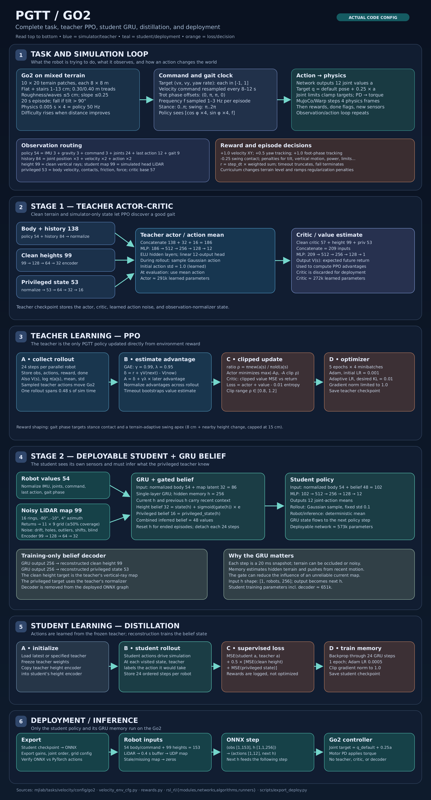

# PGTT Go2: complete ML pipeline



The [SVG poster](pgtt_ml_pipeline.svg) is a single zoomable image. Open it directly in the
editor or a browser to inspect the small labels. The PNG above is a full-size image of the
same poster. It follows the current
`Mjlab-Velocity-PGTT-{Teacher,Student}-Unitree-Go2` configuration. `B` below means the
number of parallel simulated robots.

## 1. Task: what is being learned?

The Go2 must track a requested planar velocity and yaw rate while traversing flat ground
and ascending or descending stairs, plus moderate rough terrain. The [terrain recipe](../mjlab/terrains/config.py)
has 10 difficulty rows and 20 columns of 8 m × 8 m patches. Stair rises span 1–13 cm;
the four stair variants use 30 or 40 cm treads. The mixed recipe uses 20% flat, 50%
stairs, 10% roughness (up to 5 cm), 15% slopes (up to 0.25 gradient), and 5% waves
(up to 5 cm amplitude). These ranges define training coverage, not a hardware guarantee.
The velocity command samples each of
`vx`, `vy`, and `yaw_rate` from `[-1, 1]` and resamples after 8–12 s. A separate trot
clock has per-leg offsets `(0, π, π, 0)` and samples 1–3 Hz on reset. Its phase is an
observation and reward target; the policy still chooses joint actions.

One environment step lasts `0.005 s physics timestep × 4 substeps = 0.02 s`, so the
policy runs at 50 Hz. Its 12 outputs become joint position targets by
`q_target = q_default + 0.25 × action`, clamped to the model's joint limits in both
new training runs and deployment export. PD actuators turn those targets into torque.
An episode ends after 20 s or when body tilt exceeds 90°.

The active reward is a weighted sum, multiplied by the 0.02 s step duration. The main
positive terms are XY velocity tracking (`+1`), yaw-rate tracking (`+0.5`), and the
terrain-aware foot-phase reward (`+1`). Penalties cover swing contact, body motion,
orientation, action rate, joint power/torque/limits, pose deviation, and termination.
Optional zero-weight terms do not run until enabled. The exact terms and weights are in
[the task configuration](../mjlab/tasks/velocity/velocity_env_cfg.py) and the
[reward functions](../mjlab/tasks/velocity/mdp/rewards.py).

For each leg, the foot-phase target is its ground-relative standing height during
`0 ≤ phase < π`. During `π ≤ phase < 2π`, it rises and falls through a smooth swing
trajectory. The swing apex is `0.08 m + nearby terrain height range`, with the added
height capped at `0.15 m`. The reward sums
`exp(-(desired_foot_height - actual_foot_height)^2 / 0.0025)` across the four legs.
The clean height scanner provides the terrain heights used by this reward.

At reset, [terrain curriculum](../mjlab/tasks/velocity/mdp/curriculums.py) moves a
robot to a harder patch if it walked farther than half its patch length. A robot that
falls short of half its commanded distance moves to an easier patch. Several penalty
weights ramp from 10% to full strength over `1500 × 24` training steps.

## 2. Observation routing

| Group | Shape per robot | Meaning |
|---|---:|---|
| `policy` | 54 | IMU angular velocity 3, projected gravity 3, velocity command 3, joint position 12, joint velocity 12, last action 12, gait clock 9 |
| `proprio_history` | 84 | Joint position history `3×12`, velocity history `2×12`, action history `2×12` |
| `height` | 99 | Clean 11×9 yaw-aligned downward-ray terrain map |
| `height_noisy` | 99 | Simulated head LiDAR returns converted to the same grid, then corrupted |
| `privileged` | 53 | Body linear velocity, foot contacts/forces/normals, friction, leg contact, external wrench |
| `critic` | 57 | Clean `policy`-style body data plus body linear velocity |

The [teacher routing](../mjlab/tasks/velocity/config/go2/rl_cfg.py) concatenates
`policy + proprio_history` for 138 actor body inputs, and uses the clean height 99 and
privileged 53 separately. Its critic concatenates `critic + height + privileged` for
209 inputs. The student sees `policy` 54 and `height_noisy` 99. Clean heights and
privileged data are present **only as training targets and teacher inputs** in stage 2.

The student LiDAR simulation emits 16 elevation rings from `-80°` to `-10°` with 4°
azimuth spacing, from an approximate head mount `(0.28, 0, 0.03)` relative to the base.
The [map builder](../mjlab/tasks/velocity/mdp/observations.py) places returns in the
nearest cell of an 11×9 grid, uses a low height quantile when a cell has at least two
points, and returns an all-zero map below 50% cell coverage. Noise adds jitter, drift,
outliers, missing cells, map shifts, and blind episodes. The mount geometry is an
approximation until checked against the physical Go2's TF.

## 3. Stage 1: teacher PPO

The [teacher actor](../mjlab/rsl_rl/networks/teacher_mlp.py) has three branches:

```text
body + history: 138 ── normalization ──────────────────────────────┐
clean map:      99 ── 128 ── 64 ── 32 ────────────────────────────┤
privileged:     53 ── normalization ── 64 ── 32 ── 16 ────────────┤
                              concatenate 186 → 512 → 256 → 128 → 12 action means
```

The [critic](../mjlab/rsl_rl/modules/actor_critic_wild.py) is a separate
`209 → 512 → 256 → 128 → 1` MLP estimating future return. Hidden layers use ELU.
The actor's mean and learned Gaussian standard deviation define the sampled training
action. At evaluation, the action is the mean. The teacher is feedforward: its history
arrives as explicit observation values, rather than as a GRU state.

The [on-policy runner](../mjlab/rsl_rl/runners/on_policy_runner.py) gathers 24 steps per
robot. It records observations, actions, rewards, done flags, value estimates, and old
action probabilities. [PPO](../mjlab/rsl_rl/algorithms/ppo.py) computes returns with
generalized advantage estimation (GAE), using `γ = 0.99` and `λ = 0.95`:

```text
δ_t = r_t + γ V(s_{t+1}) - V(s_t)
A_t = δ_t + γλ A_{t+1}                 (until the episode boundary)
ρ_t = π_new(a_t | s_t) / π_old(a_t | s_t)
actor loss = mean max(-A_t ρ_t, -A_t clip(ρ_t, 0.8, 1.2))
total loss = actor loss + clipped value loss - 0.01 × entropy
```

It normalizes advantages, uses five learning epochs and four minibatches per rollout,
and clips gradient norm to 1. Adam starts at `0.001`; the adaptive schedule compares
policy KL divergence to a target of `0.01`. The configuration requests 10,000 teacher
iterations and saves a checkpoint every 100 iterations.

## 4. Stage 2: student with GRU belief

The teacher checkpoint initializes a frozen teacher in
[StudentTeacherWild](../mjlab/rsl_rl/modules/student_teacher_wild.py). Its trained
height encoder is also copied into the student's height encoder. The student does not
receive the teacher's privileged observations during inference.

```text
body/command 54 ── normalize ───────────────────────┐
noisy map 99 ── 128 ── 64 ── 32 (e_t) ───────────────┤
                        [54 + 32 = 86, previous h] → GRU(86, 256) → new h

height belief 32 = height_state(h) + sigmoid(gate(h)) × e_t
privileged belief 16 = privileged_state(h)
belief 48 + normalized body 54 = 102 → 512 → 256 → 128 → 12 actions

training only: GRU output 256 → decoder → clean height 99 + privileged state 53
```

The [GRU and gate](../mjlab/rsl_rl/networks/belief_encoder.py) let the student use
recent motion when the current terrain grid has gaps or noise. Its hidden state is
`[1, B, 256]`: one layer, one row per robot. It is reset for finished episodes and
detached after each training sequence. The gate is learned from data; it is not a
handwritten threshold.

Inside the GRU, learned gates decide what to retain from the previous 256-value state.
For the 86-value input `x_t`, the simplified update is:

```text
update z_t = sigmoid(Wz x_t + Uz h_previous + bias)
reset  r_t = sigmoid(Wr x_t + Ur h_previous + bias)
candidate n_t = tanh(Wn x_t + r_t × (Un h_previous) + bias)
h_t = (1 - z_t) × n_t + z_t × h_previous
```

These are GRU gates. The **separate height gate** after the GRU computes
`sigmoid(MLP(h_t))` and controls how strongly the current LiDAR features affect the
height belief. Neither gate is a fixed if/else rule.

During a 24-step rollout, **student actions drive the simulated robot**. At each state
the frozen teacher supplies the action it would have taken there. The
[distillation algorithm](../mjlab/rsl_rl/algorithms/distillation_wild.py) then replays
those ordered observations through the student and minimizes:

```text
L = MSE(student action, teacher action)
    + 0.5 × [MSE(decoded clean height, clean height)
             + MSE(decoded privileged state, normalized privileged state)]
```

It backpropagates through at most 24 GRU steps, trains for one epoch per rollout, uses
Adam at `0.0005`, and clips gradient norm to 1. The student's rollout action has
fixed Gaussian exploration std `0.1`; the deployed action uses the deterministic
mean. Environment rewards are logged during this stage but are not part of this loss.
The configuration requests 5,000 student iterations.

## 5. Robot inference and decision points

The [export script](../scripts/export_deploy.py) emits the student policy as ONNX and a
`deploy.yaml` with observation order, joint mapping, action scale, gains, and map
configuration. It checks ONNX actions against the PyTorch policy. The deployed graph
contains the normalizer, height encoder, GRU, gated belief, and action MLP; it excludes
the teacher, critic, and reconstruction decoder.

```text
input:  obs [1, 153] = 54 body/command + 99 height values
        h_in [1, 1, 256]
output: actions [1, 12], h_out [1, 1, 256]
next step uses h_out as h_in
```

The [ROS 2 LiDAR bridge](../scripts/lidar_height_map.py) sends the 99-cell map over UDP
to the [controller's height-map input](../deploy/include/isaaclab/devices/height_map/height_map.h).
It transforms points into a gravity-aligned world frame, retains up to 0.4 s of recent
points, then samples the grid around the latest base pose. If the cloud is too sparse,
the bridge stops sending. If the controller has no fresh
map, it gives the student zeros, a case seen during training. Those zeros indicate
"no usable map" to the network; they do not prove that the ground is flat.

| Decision | Implemented behavior |
|---|---|
| Gait phase | Clock sets expected stance or swing and informs rewards; network chooses joints. |
| Teacher exploration | Sample from a learned Gaussian during PPO rollout; use mean for evaluation. |
| PPO update | Clamp probability ratio and value update; adapt learning rate around target KL. |
| Student map | Missing/low-coverage cells are zero; whole map is zero below coverage threshold. |
| Student trust in map | GRU gate learns the blend between present map features and memory. |
| Episode end | Reset environment and student GRU on fall or time limit. |
| Robot deployment | Feed next GRU state back each step; apply 12 joint targets through PD motors. |

The other `rsl_rl` actor–critic, recurrent, RND, symmetry, and standard distillation
modules are reusable implementations for other tasks or optional settings. The
PGTT Go2 configuration selects `ActorCriticWild` + PPO for the teacher and
`StudentTeacherWild` + `DistillationWild` for the student.
